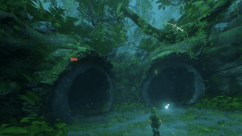
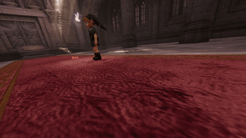

# Ocarina VR Remake Edition

Play the *Ocarina of Time* remake in stereo VR on Windows x64. This unofficial mod uses your own copy of game version **1.1.1** and **NX2navi 0.10.1**.

## Getting started

1. Enable **Keep Build Cache** in NX2navi 0.10.1 and build your game. If you built it with the cache turned off, enable it and build again.
2. Run Ocarina VR Setup and select your NX2navi installation. Setup builds the VR player on your PC.
3. Connect your headset through an OpenXR runtime. Open the Ocarina VR launcher and select **Play in VR**.

## Recommended settings for Quest 3

| Setting | What to use |
| --- | --- |
| PC connection | Virtual Desktop |
| Virtual Desktop frame rate | 72 FPS (72 Hz) |
| Virtual Desktop Synchronous Spacewarp (SSW) | Enabled |
| Ocarina VR launcher | Keep the default settings |

## Known issues

- **Market textures.** On the first visit, some objects appeared white while shaders were compiling. They looked normal on the next visit.
- **Right-eye dust.** Floating specks can flicker between positions in the right eye. The effect is subtle.
- **Stuttering.** Gameplay can occasionally hitch.

## Around Hyrule in VR

**Lost Woods**

**Market square**

**Temple of Time**

